<p align="left">
  
</p>

**A single-binary VM & infrastructure control plane for Linux.**
Run virtual machines and containers, software-defined storage and networking,
and multi-node clustering — all from one web UI, backed by one self-contained Go
binary with no external database and no agents.

[](LICENSE)


VXVisor is an original, from-scratch platform inspired by the shape of Proxmox
and vSphere. It installs in minutes, ships as a single binary (templates and
assets embedded, pure-Go SQLite — no CGO), and makes no outbound/telemetry
calls.

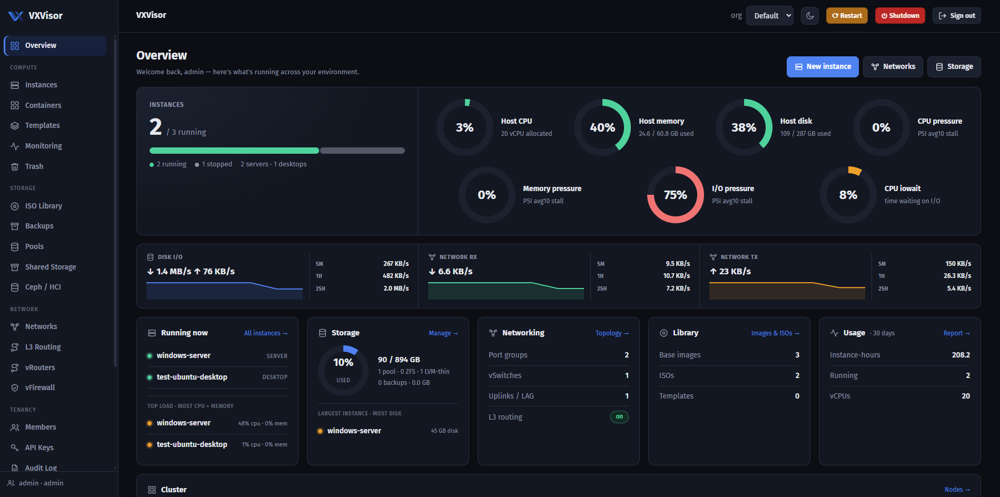

---

## Highlights

- **Compute** — QEMU/KVM virtual machines and **LXC** system containers, with
  live console (noVNC), snapshots, backups, and cloud-init provisioning.
- **Storage** — directory, NFS, CIFS, Ceph and iSCSI pools; **ZFS** (pools,
  datasets, caches) and **LVM**; software RAID; qcow2 or raw disks.
- **Networking** — VMware-style vSwitches → port groups (VLANs) → uplinks with
  teaming; built-in **L3 routing** (static, OSPF, BGP) and NAT/firewall;
  virtual routers and a drag-and-drop firewall.
- **Clustering** — join multiple hosts, manage them from one address, place and
  **live-migrate** VMs between nodes.
- **Import / Export** — bring VMs in from VMware vCenter/ESXi (read-only, the
  source is never changed) and export them back out.
- **Operations** — live and historical metrics, alerts, audit log, quotas, and
  usage reporting.
- **Multi-tenant** — organizations, members, roles, API keys, and Active
  Directory / OIDC single sign-on.

---

## Screenshots

### Instances & monitoring
| Instances | Monitoring |
|---|---|
| 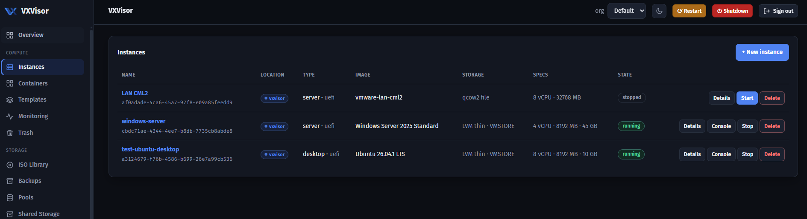 | 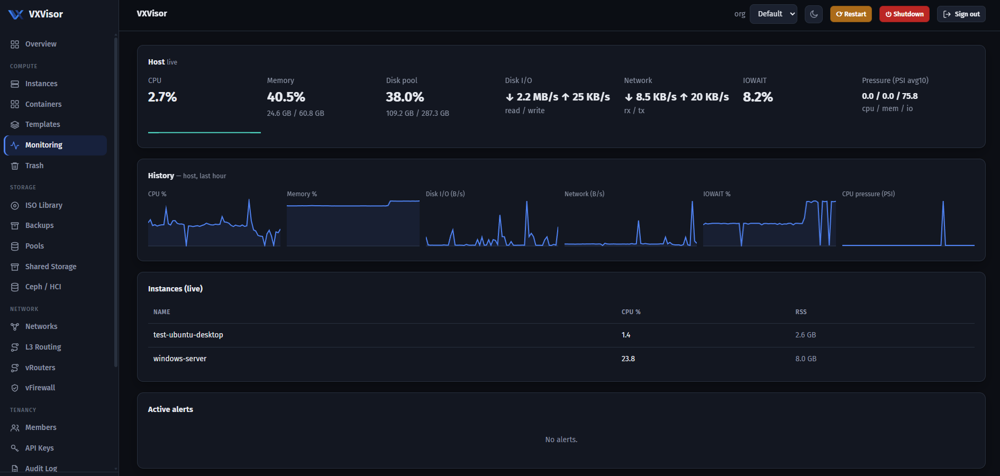 |

### Networking
| vSwitches & port groups | Uplinks & teaming |
|---|---|
| 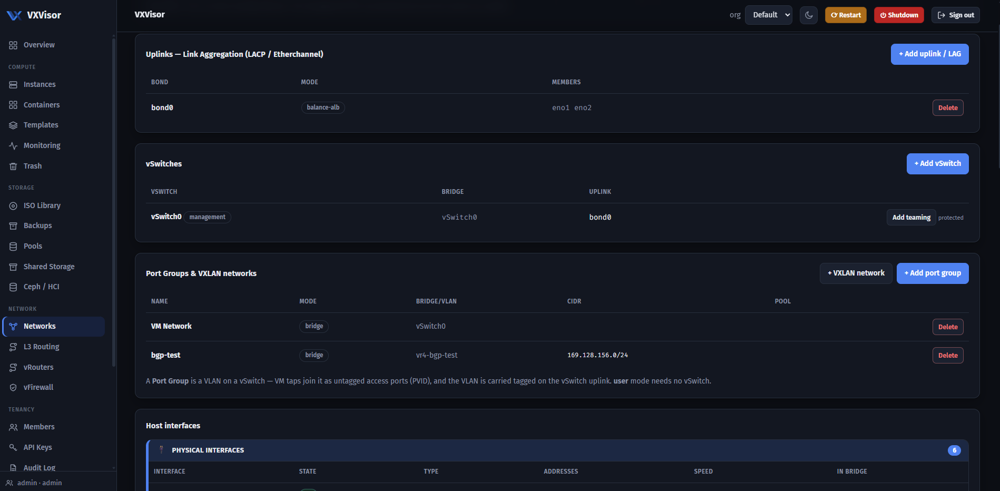 | 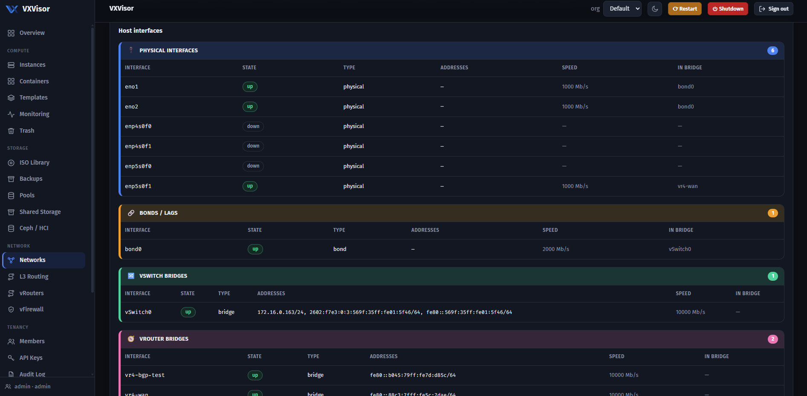 |

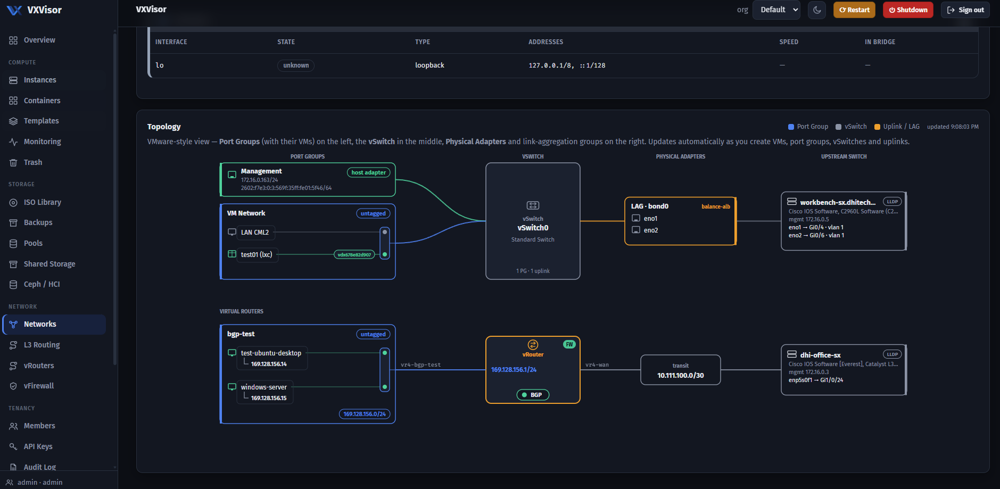

### Virtual routers & firewall
| Virtual routers | Firewall |
|---|---|
| 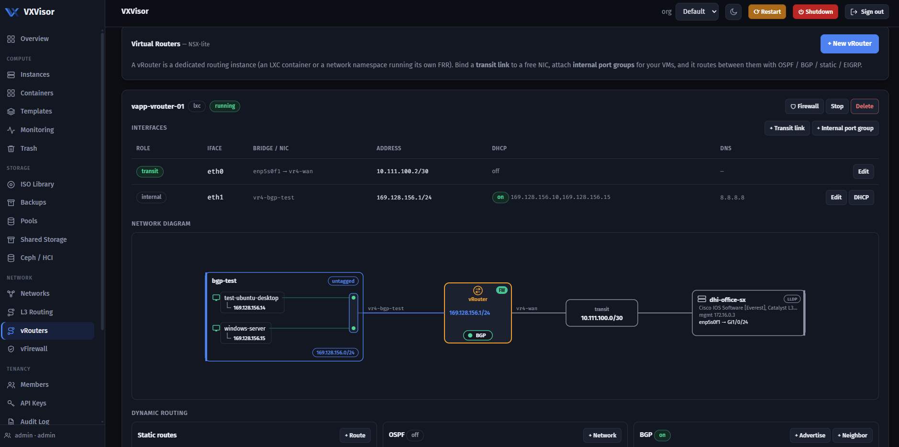 | 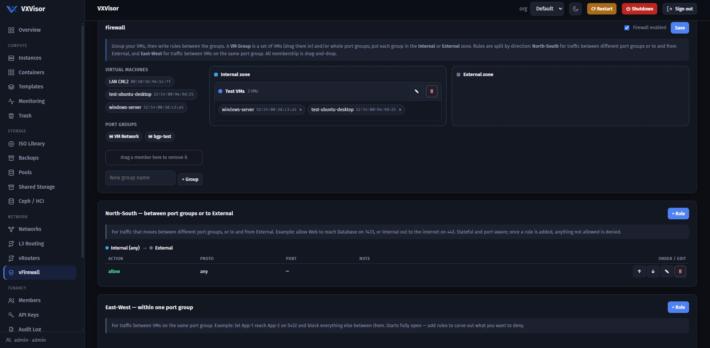 |

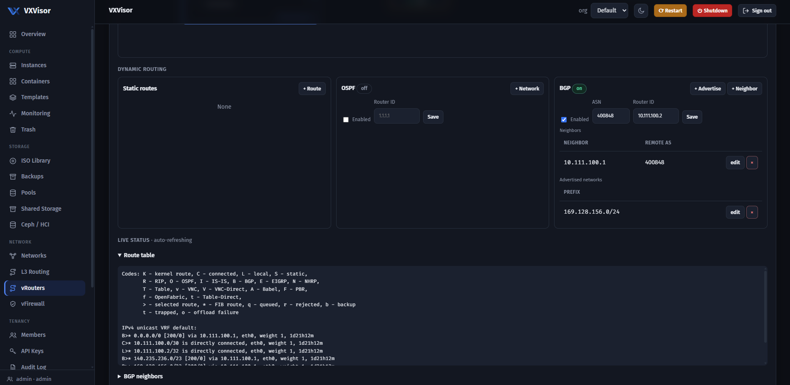

### Storage
| Pools | Disks | Build a pool |
|---|---|---|
| 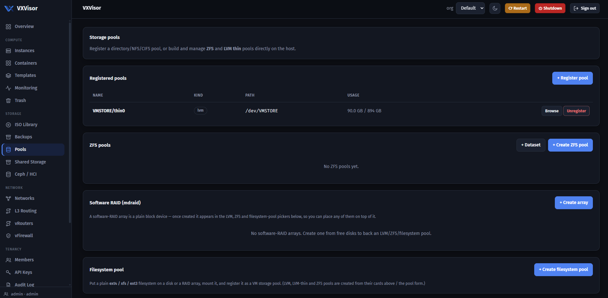 | 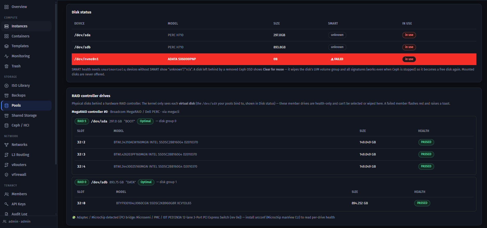 | 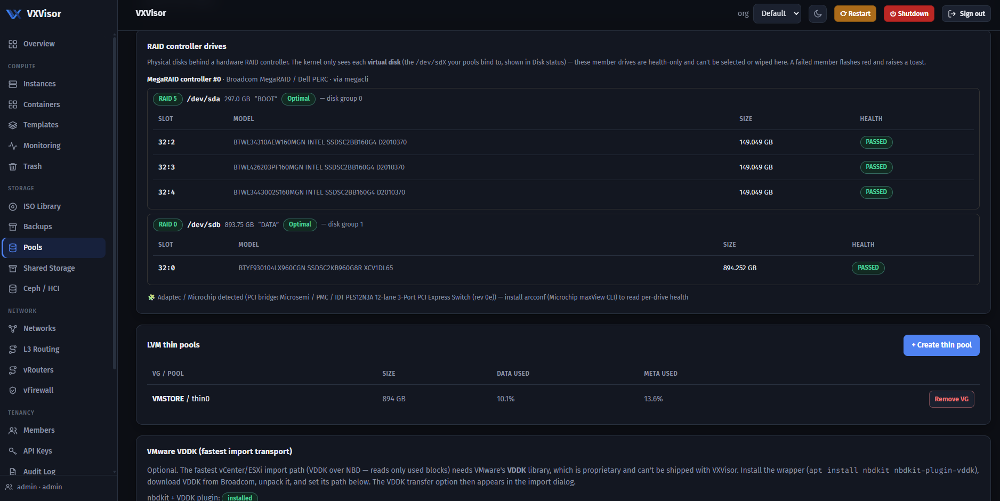 |

### Containers, clustering & migration
| Containers | Clustering |
|---|---|
| 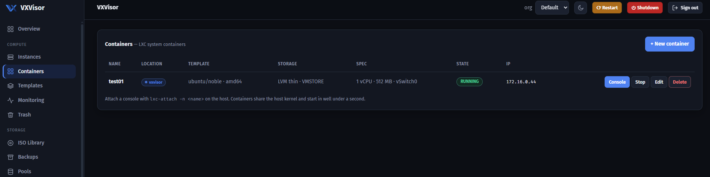 | 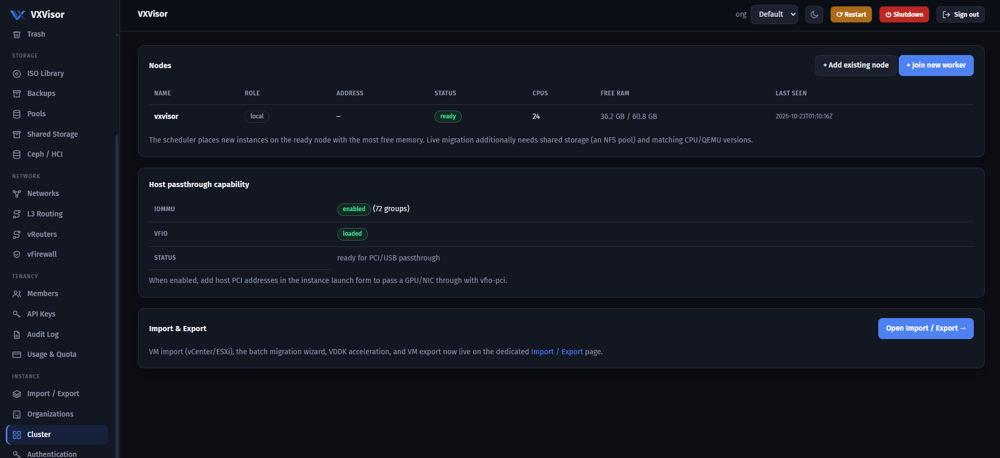 |

| Import / Export (VMware) | ISO library |
|---|---|
| 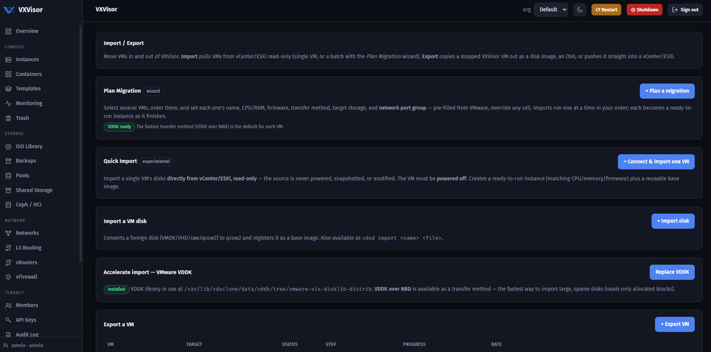 | 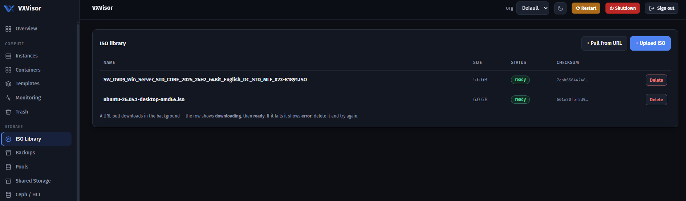 |

---

## Quick start

On a 64-bit Linux host with hardware virtualization (`/dev/kvm`):

```bash
# 1. Build the binary (or use a prebuilt vdxd)
CGO_ENABLED=0 GOOS=linux GOARCH=amd64 go build -trimpath \
  -ldflags "-s -w -X main.version=$(git describe --tags --always)" \
  -o dist/vdxd ./cmd/vdxd

# 2. Copy the binary + deploy/ to the host, then on the host:
sudo ./install.sh --ip <this-host-IP>   # installs deps, service, config
sudo vdxd user add admin --admin         # create the first admin
sudo systemctl enable --now vdxd
```

Open **`http://<this-host-IP>:8766`** and sign in.

👉 **Full step-by-step guide:** [`docs/INSTALL.md`](docs/INSTALL.md)
(prerequisites, installer options, first steps, upgrading, and where files live).

> **Production tip:** front the admin UI with a TLS reverse proxy (Caddy/nginx).

---

## Configuration

- Config file: `/etc/vdxclone/config.toml` (a starter is written on install).
- Data (database, VM disks, backups): `/var/lib/vdxclone/`.
- Images and ISOs: `/var/cache/vdxclone/`.
- Logs: `journalctl -u vdxd -f`.

The admin UI listens on `:8766`. Most day-to-day settings are configured from
the UI itself.

---

## Architecture

- **One binary.** The daemon/CLI is `vdxd`. The web UI and assets are embedded.
- **No external services.** State lives in an embedded SQLite database
  (`modernc.org/sqlite`, pure Go). Migrations run automatically on start.
- **No agents.** VXVisor drives standard host tooling (QEMU/KVM, LXC, ZFS/LVM,
  FRR, nftables) directly; in a cluster, nodes coordinate over an authenticated
  peer channel with a floating management address.
- **Safe by default.** Licensing enforcement is off, there are no telemetry or
  outbound calls, consoles bind to loopback and are only reachable through the
  authenticated proxy, and destructive operations guard the management interface
  and in-use disks.

See [`OVERVIEW.md`](OVERVIEW.md) for a module-by-module technical breakdown.

---

## License

VXVisor is licensed under the **Business Source License 1.1** (see
[`LICENSE`](LICENSE)).

In short:
- You can **read, modify, self-host, and use it in production** — including
  commercially, for your own organization.
- You **cannot** offer VXVisor to third parties as a competing hosted or managed
  service.
- Each released version automatically converts to the **Apache License 2.0** on
  its Change Date (four years after release).

This is a source-available license, not an OSI open-source license (until the
Change Date). For other arrangements, open an issue.

VXVisor bundles third-party components under their own permissive licenses
(MIT, BSD, Apache-2.0, MPL-2.0), and invokes separate programs at runtime
(QEMU, FRR, LXC, smartmontools, and others) that keep their own licenses.

---

## Docs

- [`docs/INSTALL.md`](docs/INSTALL.md) — installation guide.
- [`OVERVIEW.md`](OVERVIEW.md) — technical overview: how each module works.
- [`docs/TUNING.md`](docs/TUNING.md) — performance tuning.

> Note: the Go module is named `vdxclone` for historical reasons; the product is
> **VXVisor**. The repository name and module path differ, which is fine.
